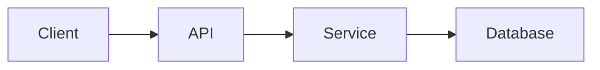

# Plan: [feature name]

| Field | Value |
| --- | --- |
| Spec | `specs/[NNN-feature]/spec.md` |
| Status | Draft / Approved |
| Author | [name] |

## Summary

[Describe the approach in three to five sentences.]

## Architecture

[Describe the components that change and how data moves between them. Add a diagram when it helps.]

## Components

| Component | Change | Notes |
| --- | --- | --- |
| `[module or service]` | New / Modified / Removed | [detail] |

## Data model and interfaces

[Describe schema changes, API endpoints, CLI arguments, file formats, and environment variables.]

## Dependencies

| Dependency | Version | Reason |
| --- | --- | --- |
| [package] | [pinned version] | [why] |

## Decisions

| Decision | ADR |
| --- | --- |
| [choice] | `docs/adr/[NNNN]-[title].md` |

## Risks and mitigations

| Risk | Likelihood | Impact | Mitigation |
| --- | --- | --- | --- |
| [risk] | Low / Medium / High | Low / Medium / High | [action] |

## Test strategy

- Unit tests: [scope]
- Integration tests: [scope]
- Manual verification: [steps]

## Rollout and rollback

- Rollout: [feature flag, staged deploy, migration order]
- Rollback: [exact steps to revert]
