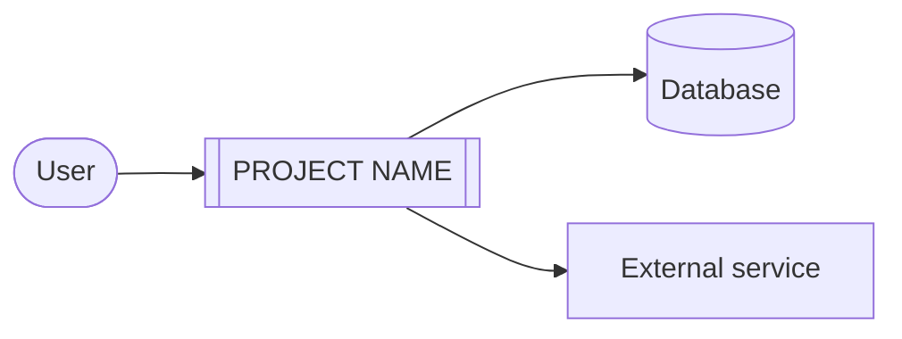

# [PROJECT NAME]

[One-sentence description of what the project does and who it is for.]

[](https://github.com/[OWNER]/[REPO]/actions)

## Overview

[Two to four sentences: the problem, the approach, and the main result or output.]

**Features:**

- [Feature one]
- [Feature two]
- [Feature three]

## Architecture



| Component | Technology | Location |
| --- | --- | --- |
| [API / CLI] | [FastAPI / Spring Boot / Bash] | `src/` |
| [Database] | [PostgreSQL] | `compose.yaml` |

## Requirements

- [Python 3.11+ with uv / Java 21 with Maven / Node 22]
- Docker with Compose (optional, for local services)
- [Other tool or access requirement]

## Quick start

```bash
git clone https://github.com/[OWNER]/[REPO].git
cd [REPO]
make setup        # install dependencies, create .env
make up           # start local services
make run          # run the application
```

## Usage

```bash
[COMMAND] --help
[COMMAND] [EXAMPLE ARGUMENTS]
```

Expected output:

```text
[EXAMPLE OUTPUT]
```

## Configuration

Copy `.env.example` to `.env` and set the values. `make setup` does this step automatically.

| Variable | Default | Description |
| --- | --- | --- |
| `LOG_LEVEL` | `INFO` | `DEBUG`, `INFO`, `WARN`, or `ERROR` |
| `DATABASE_URL` | none | Database connection string |
| `[VARIABLE]` | `[DEFAULT]` | [Description] |

## Development

| Command | Action |
| --- | --- |
| `make lint` | Check code style |
| `make format` | Apply formatting |
| `make test` | Run tests |
| `make check` | Run lint and tests |
| `make build` | Build the package or artifact |
| `make docker-build` | Build the container image |

Run `make check` before you push.

## Project structure

```text
.
├── src/            application code
├── tests/          tests
├── specs/          feature specs, plans, and tasks
├── docs/           runbook and ADRs
├── scripts/        utility scripts
└── Makefile        standard commands
```

## Deployment

See [docs/RUNBOOK.md](docs/RUNBOOK.md) for environments, deployment, rollback, and troubleshooting.

## Troubleshooting

| Problem | Fix |
| --- | --- |
| `make setup` fails | Run `make info` to check the detected toolchain |
| Service connection refused | Run `make up`, then `make ps` |
| [Problem] | [Fix] |

## License

[MIT]. See [LICENSE](LICENSE).
